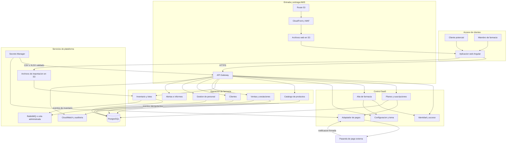
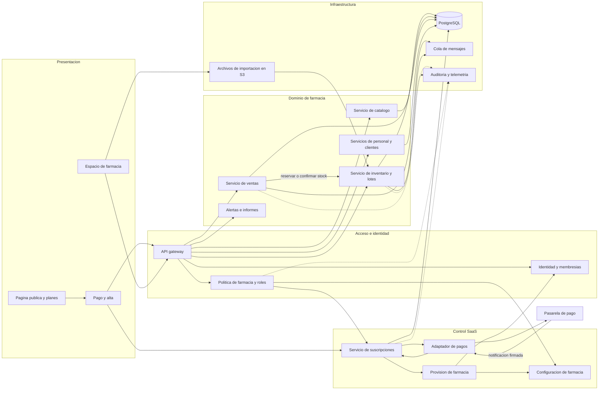

# Arquitectura objetivo de KipuSalud

Este documento propone una arquitectura futura para ampliar el sistema actual hacia un SaaS de gestión farmacéutica. No describe capacidades que ya estén implementadas; los componentes comerciales, multi-tenant, de lotes y de operación en AWS son propuestas pendientes de desarrollo. El PDF del proyecto permanece como fuente inmutable de alcance y objetivos.

## Application Architecture

La solución se divide en un plano SaaS para contratación, suscripción y aprovisionamiento, y un plano operativo para el trabajo diario de cada farmacia. En la primera versión, cada suscripción se asocia a una sola farmacia.

<!-- mermaid-checked: no \n, no em-dash/en-dash, no {} in labels, subgraphs are id["label"], arrows are -->|"label"|, all subgraphs closed by end, ids unique -->

### Technology Stack Summary

| Layer | Technology | Version | Purpose |
|---|---|---|---|
| Web client | Angular and TypeScript | Angular 21.1; TypeScript 5.9 | Public introduction, plan selection, onboarding and pharmacy workspace |
| Application services | Java and Spring Boot | Java 17; Spring Boot 3.2.3 | SaaS control plane and pharmacy business capabilities |
| API edge | AWS API Gateway or an equivalent managed edge | To be selected | TLS termination, routing, throttling and public API entry point |
| Data | PostgreSQL | Existing Docker baseline is PostgreSQL 16 | Subscription, pharmacy and operational records with tenant scoping |
| Messaging | RabbitMQ or a managed AWS queue | Existing project uses RabbitMQ | Asynchronous notifications and integration events; not the sole mechanism for committing a sale's stock |
| Static content and imports | Amazon S3 | Managed service | Serve static web assets and temporarily stage validated inventory imports |
| Containers | Docker on Amazon ECS with Fargate | To be selected | Run backend services without managing host servers |
| Secrets and observability | AWS Secrets Manager and CloudWatch | Managed services | Keep credentials out of images and environment files; collect logs, metrics and alerts |
| Delivery automation | GitHub Actions and Amazon ECR | To be designed | Build, test, scan and publish versioned application images |
| Payment | Provider-neutral adapter | Provider not selected | Isolate checkout, payment confirmation, refunds and recurring billing from a specific vendor |

### Data Storage & External Services

PostgreSQL stores the control-plane records (accounts, plan definitions, subscriptions, payment references and pharmacy provisioning state) and operational data (catalog, lots, movements, sales, employees and customers). Each operational record must be scoped to its pharmacy. The application must derive the pharmacy context from the authenticated membership, never trust a tenant identifier supplied only by the browser, and enforce tenant isolation in service authorization and database queries. PostgreSQL row-level security can be added as defense in depth after its connection-pool and tenant-context behavior is tested. Services must own their data and must not read or write another service's tables directly; databases or schemas should be assigned per service boundary.

S3 stages uploaded CSV/XLSX files; the application parses them, validates a preview and commits accepted rows through the inventory service. Customer-provided SQL is not executed. A provider adapter handles payment checkout and signed, idempotent webhooks. RabbitMQ is suitable for non-blocking events and notifications, but a sale must reserve or decrement inventory through an idempotent, acknowledged operation with a defined failure/retry path. AWS Secrets Manager stores production credentials, and CloudWatch collects operational telemetry. The AWS services named here are a proposed target, not resources currently provisioned in the repository.

### Key Architectural Decisions

- Separate the SaaS control plane (plans, payment state, onboarding and tenant configuration) from the pharmacy operational plane (inventory and sales).
- Start the new SaaS control plane as a cohesive deployable module/service rather than a microservice for every small capability. Keep operational service boundaries where they provide clear ownership, with explicit APIs and data ownership.
- Model user access through memberships scoped to one pharmacy. Distinguish the platform operator from the pharmacy's primary administrator, manager and employee.
- Treat inventory as lot-based: record receipts, lot expiry, sales, adjustments and cancellations in an append-only movement history. A sale cancellation must retain the original sale, reason, actor and timestamp.
- Use a provider-neutral payment contract and idempotent webhook handling; activate provisioning only after verified payment confirmation.
- Store payment-provider references and tokens only; KipuSalud must not store raw card details.
- Restrict theme customization to supported design tokens and layout options. Do not allow customer-supplied HTML, CSS or executable scripts.
- Keep billing state authoritative for access: paid access, seven-day grace after a failed renewal, then read-only access. Define any later suspension or cancellation policy before launch.

## Component Relationships

The target component view shows the main interactions between the new SaaS capabilities and the existing Angular/Spring service structure. Components tagged as proposed require design and implementation; their presence here does not imply they exist in the current code.

<!-- mermaid-checked: no \n, no em-dash/en-dash, no {} in labels, subgraphs are id["label"], arrows are -->|"label"|, all subgraphs closed by end, ids unique -->

### Component Inventory

| Component | Layer | Type | Responsibility |
|---|---|---|---|
| Public landing and plans | Presentation | Existing frontend to extend | Explain the service, display plans and start signup |
| Checkout and onboarding | Presentation | Proposed Angular flow | Select plan, complete checkout, create pharmacy and configure initial administrator |
| Pharmacy workspace | Presentation | Existing Angular app to extend | Login and use pharmacy management functions |
| API gateway | Edge and identity | Existing Spring Cloud Gateway | Single API entry point; add throttling, route policy and production edge integration |
| Identity and membership | Edge and identity | Existing auth service to extend | Authenticate users, associate them with pharmacies and issue scoped identity claims |
| Tenant and role policy | Edge and identity | Proposed authorization component | Resolve pharmacy membership and enforce platform, pharmacy-admin, manager and employee permissions |
| Subscription service | SaaS control plane | Proposed service or module | Own plans, billing period, state transitions, renewals, grace period and access state |
| Payment adapter | SaaS control plane | Proposed integration boundary | Translate provider checkout, webhook, refund and recurring-payment operations |
| Pharmacy provisioning | SaaS control plane | Proposed application service | Create a pharmacy and its primary admin after verified payment |
| Tenant configuration | SaaS control plane | Proposed service or module | Store supported theme tokens, layout options and pharmacy-level settings |
| Catalog service | Pharmacy domain | Existing Spring service | Manage product and category master data |
| Inventory and lot service | Pharmacy domain | Proposed expansion or new service | Record receipts, lots, expiry dates, stock movements, adjustments and stock reservations |
| Sales service | Pharmacy domain | Existing Spring service to extend | Create sales, coordinate inventory, and cancel sales through audited reversals |
| Employee and customer services | Pharmacy domain | Existing Spring services | Maintain pharmacy-scoped personnel and customer records |
| Alerts and reports | Pharmacy domain | Proposed capability | Surface expiry and minimum-stock alerts and support operational reporting |
| PostgreSQL | Infrastructure | Existing data store | Persist control-plane and pharmacy data with tenant isolation |
| Message broker | Infrastructure | Existing RabbitMQ | Carry retryable asynchronous events and notifications |
| S3 import staging | Infrastructure | Proposed managed storage | Hold uploads while they are parsed, validated and imported |
| Audit and telemetry | Infrastructure | Proposed cross-cutting service | Record privileged actions and provide diagnostic logs, metrics and alerts |
