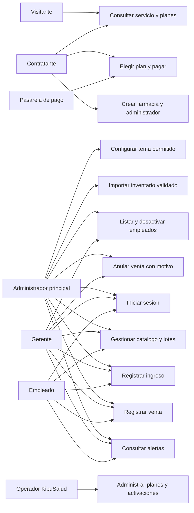

# Casos de uso propuestos para KipuSalud

Este catálogo traduce a flujos verificables la arquitectura SaaS propuesta y los objetivos descritos en los capítulos 1 y 2 del informe. Es un artefacto complementario: no altera ni reemplaza el PDF. Las capacidades que no existen todavía en el código se identifican como pendientes de implementación.

## Decisiones de partida

- Una suscripción habilita una farmacia en la primera versión.
- La pasarela de pago queda desacoplada; el proveedor se decidirá más adelante.
- Los cobros de renovación fallidos tienen siete días de acceso completo de gracia; después, el acceso queda en modo de solo lectura.
- El inventario se importa mediante CSV/XLSX con plantilla, validación y vista previa. No se ejecuta SQL entregado por clientes.
- Gerente y administrador principal pueden consultar empleados y solicitar la anulación de ventas. Una venta se anula con motivo y auditoría; no se elimina físicamente.
- La baja de un empleado se modela como desactivación de su membresía, no como borrado físico, para conservar la atribución histórica de sus operaciones.
- Los roles de farmacia son administrador principal, gerente y empleado. El operador de la plataforma es un rol separado, reservado al personal de KipuSalud.
- Los detalles todavía por acordar incluyen precios, moneda, renovación, reembolsos, vencimiento/cancelación posterior al modo de solo lectura, mecanismo de verificación del correo y si las herramientas del operador KipuSalud forman parte de la primera versión.

## Actores

| Actor | Descripción |
|---|---|
| Visitante | Persona que consulta el servicio antes de registrarse |
| Contratante | Persona que selecciona y paga un plan, y comienza el alta de una farmacia |
| Administrador principal | Responsable de la farmacia y de administrar su cuenta y permisos |
| Gerente | Gestiona operaciones de la farmacia y tiene permisos administrativos definidos |
| Empleado | Usuario operativo con permisos limitados |
| Proveedor de pago | Sistema externo que procesa cobros y envía notificaciones firmadas |
| Operador KipuSalud | Personal interno que administra soporte de plataforma; no equivale al administrador de una farmacia |

## Vista general de casos de uso

La figura es un mapa funcional de actores y casos, no una frontera de autorización. Todas las acciones sobre datos deben verificarse también en el backend y limitarse a la farmacia autenticada.

<!-- mermaid-checked: no \n, no em-dash/en-dash, no {} in labels, subgraphs are id["label"], arrows are -->|"label"|, all subgraphs closed by end, ids unique -->

## Casos de uso detallados

### CU-01 - Consultar el servicio y los planes

**Actor principal:** Visitante  
**Objetivo:** Entender el servicio, sus beneficios, planes, limitaciones y condiciones antes de contratarlo.  
**Precondiciones:** Ninguna.  
**Flujo principal:**

1. El visitante abre la página pública.
2. El sistema muestra la propuesta de valor, las funciones disponibles, los planes y sus condiciones.
3. El visitante selecciona un plan para iniciar la contratación.

**Alternativas y errores:** Si el servicio no está disponible, la página informa que no se puede iniciar una contratación en ese momento.  
**Postcondición:** Se inicia el flujo de checkout con el plan elegido; aún no existe una farmacia activa.

### CU-02 - Contratar un plan

**Actor principal:** Contratante  
**Actor secundario:** Proveedor de pago  
**Objetivo:** Pagar un plan mensual o anual y habilitar el alta de una farmacia.  
**Precondiciones:** El contratante seleccionó un plan publicado.  
**Flujo principal:**

1. El sistema presenta el plan, período, precio, moneda, renovación y condiciones.
2. El contratante confirma los datos y continúa al medio de pago.
3. El sistema solicita el cobro mediante el adaptador de pasarela.
4. El proveedor procesa el pago.
5. El adaptador valida la notificación firmada y evita procesar dos veces el mismo evento.
6. El sistema registra el pago confirmado y habilita el alta de farmacia.

**Alternativas y errores:**

- Si el pago es rechazado o cancelado, el sistema no activa la suscripción ni provisiona la farmacia.
- Si no llega la confirmación del proveedor, el estado queda pendiente y se consulta o reconcilia antes de permitir el alta.
- Si el mismo webhook llega más de una vez, se registra como repetido sin duplicar el pago ni el aprovisionamiento.

**Postcondición:** Existe una suscripción pagada pendiente de completar el alta de farmacia.  
**Reglas:** No confiar en la redirección del navegador como prueba de pago; confirmar mediante webhook validado o consulta autenticada al proveedor.

### CU-03 - Crear una farmacia y asignar su administrador principal

**Actor principal:** Contratante  
**Objetivo:** Configurar la farmacia asociada a la suscripción.  
**Precondiciones:** Pago confirmado; suscripción habilitada para una farmacia y todavía no consumida.  
**Flujo principal:**

1. El contratante ingresa los datos requeridos de la farmacia.
2. Define la identidad inicial del administrador principal.
3. El sistema valida los datos y crea la farmacia con estado de configuración.
4. El sistema crea la membresía del administrador principal en esa farmacia.
5. El sistema termina el aprovisionamiento y muestra la confirmación.

**Alternativas y errores:** Si el alta falla después del pago, el sistema conserva el pago y la suscripción en estado recuperable para reintentar sin cobrar otra vez. Si los datos ya existen, informa el conflicto y permite corregirlos.  
**Postcondición:** La suscripción pertenece a una farmacia; el administrador tiene membresía únicamente en esa farmacia.

### CU-04 - Configurar diseño y disposición permitidos

**Actor principal:** Administrador principal  
**Objetivo:** Personalizar ligeramente la interfaz de su farmacia.  
**Precondiciones:** Sesión autenticada y membresía activa con rol de administrador principal.  
**Flujo principal:**

1. El administrador abre la configuración de apariencia.
2. Selecciona colores, densidad o disposición de entre opciones permitidas.
3. El sistema muestra una vista previa.
4. El administrador guarda y el sistema aplica la configuración en el ámbito de su farmacia.

**Alternativas y errores:** Valores fuera del catálogo permitido se rechazan. Si guardar falla, se conserva la configuración anterior.  
**Postcondición:** La preferencia visual queda asociada a la farmacia, no a otras cuentas.  
**Reglas:** No aceptar CSS, HTML o JavaScript arbitrario del cliente.

### CU-05 - Importar inventario desde archivo

**Actor principal:** Administrador principal  
**Actores secundarios:** Gerente, según permiso concedido  
**Objetivo:** Cargar datos iniciales sin ejecutar SQL suministrado por clientes.  
**Precondiciones:** Sesión autenticada; farmacia activa; archivo dentro de los formatos, tamaños y estructura admitidos.  
**Flujo principal:**

1. El usuario descarga la plantilla o consulta el formato admitido.
2. Sube un archivo CSV/XLSX.
3. El sistema analiza columnas y valida filas, tipos, duplicados, cantidades, lotes y fechas requeridas.
4. El sistema presenta una vista previa con filas válidas y errores por fila.
5. El usuario confirma la importación.
6. El sistema guarda los datos de forma controlada y entrega un resumen.

**Alternativas y errores:** Un archivo inválido no modifica el inventario. El usuario puede corregirlo y volver a cargarlo. Reintentar la misma operación no debe duplicar registros ya confirmados.  
**Postcondición:** Los registros aceptados pertenecen exclusivamente a la farmacia autenticada y quedan reflejados en movimientos de inventario.  
**Reglas:** Rechazar SQL arbitrario; limitar tipo y tamaño de archivo; validar encabezados, rangos y contenido; impedir que un archivo sobrescriba datos de otra farmacia.

### CU-06 - Iniciar sesión

**Actor principal:** Administrador principal, gerente o empleado  
**Objetivo:** Acceder a la farmacia asociada a una membresía válida.  
**Precondiciones:** Usuario creado y asociado a una farmacia.  
**Flujo principal:**

1. El usuario envía sus credenciales.
2. El sistema autentica la identidad y consulta el estado de membresía y suscripción.
3. El sistema emite credenciales de acceso con contexto de farmacia y rol.
4. La interfaz carga las funciones autorizadas.

**Alternativas y errores:** Credenciales inválidas o membresía revocada se rechazan. Suscripción en solo lectura bloquea las operaciones de escritura.  
**Postcondición:** El usuario obtiene acceso limitado por farmacia, rol y estado de suscripción.

### CU-07 - Gestionar catálogo, lotes y fechas

**Actor principal:** Administrador principal, gerente o empleado autorizado  
**Objetivo:** Mantener el catálogo y consultar las existencias identificadas por lote.  
**Precondiciones:** Usuario autenticado con permiso de catálogo.  
**Flujo principal:**

1. El usuario consulta o registra un producto.
2. Asocia la categoría y los datos de identificación requeridos.
3. Registra uno o más lotes con fecha de vencimiento y cantidades recibidas.
4. El sistema guarda cada cambio en el ámbito de la farmacia y actualiza la vista de disponibilidad.

**Alternativas y errores:** El sistema rechaza cantidades negativas, fechas inválidas y lotes duplicados según la regla definida. Los lotes vencidos no se ofrecen para venta.  
**Postcondición:** Producto y lotes quedan almacenados y auditables.  
**Reglas pendientes de especificación:** campos regulatorios del producto, unidad de medida, identificador de lote y política de corrección de lotes.

### CU-08 - Registrar ingreso de mercadería

**Actor principal:** Administrador principal, gerente o empleado autorizado  
**Objetivo:** Registrar una recepción de proveedor con trazabilidad por lote.  
**Precondiciones:** Usuario autenticado; producto existente o posibilidad de crearlo con permiso.  
**Flujo principal:**

1. El usuario inicia una recepción y registra fecha y referencia documental si aplica.
2. Añade productos, cantidades, lotes y fechas de vencimiento.
3. El sistema valida que cada línea sea consistente.
4. El usuario confirma la recepción.
5. El sistema registra un movimiento de ingreso y actualiza existencias por lote.

**Alternativas y errores:** Si falla una validación, el sistema muestra la línea que debe corregirse y no confirma parcialmente la recepción.  
**Postcondición:** La recepción queda registrada, con usuario, fecha, farmacia y detalle por lote.  
**Relación con el informe:** Este caso permite medir el tiempo de registro y actualización del Kardex del objetivo 1.

### CU-09 - Registrar una venta y descontar inventario

**Actor principal:** Administrador principal, gerente o empleado autorizado  
**Objetivo:** Registrar una venta, validar existencias y descontar los lotes correspondientes.  
**Precondiciones:** Usuario autenticado; farmacia con suscripción habilitada para escritura; productos disponibles.  
**Flujo principal:**

1. El usuario selecciona los productos y cantidades.
2. El sistema verifica precios y disponibilidad por lotes no vencidos.
3. El sistema reserva o confirma el descuento de inventario de forma idempotente.
4. El sistema persiste venta y detalles.
5. El sistema registra los movimientos de salida y confirma el resultado.

**Alternativas y errores:**

- Si no hay stock suficiente, se rechaza la venta antes de confirmarla.
- Si no puede confirmarse el movimiento de inventario, la venta no debe presentarse como exitosa; se reintenta o compensa de forma trazable.
- Una repetición de la solicitud no debe crear una venta duplicada.

**Postcondición:** Venta confirmada y movimientos de inventario reconciliables.  
**Reglas:** Mantener consistencia entre venta y stock; evitar descuentos asíncronos que puedan dejar la venta confirmada con existencias incorrectas. La emisión SUNAT está fuera del alcance actual del informe.

### CU-10 - Consultar alertas de vencimiento y stock mínimo

**Actor principal:** Administrador principal, gerente o empleado autorizado  
**Objetivo:** Identificar lotes próximos a vencer y productos con existencias bajas.  
**Precondiciones:** Farmacia con inventario registrado y política de alertas configurada.  
**Flujo principal:**

1. El usuario abre el panel de alertas.
2. El sistema consulta lotes próximos a vencer y productos debajo del mínimo.
3. El sistema presenta producto, lote, fecha, cantidad y prioridad.
4. El usuario puede consultar el detalle o iniciar una reposición.

**Alternativas y errores:** Si todavía no se configuraron umbrales, el sistema los identifica como pendientes en vez de ocultar la falta de configuración.  
**Postcondición:** El usuario dispone de información accionable y filtrada por su farmacia.

### CU-11 - Consultar empleados

**Actor principal:** Gerente o administrador principal  
**Objetivo:** Consultar las membresías y el personal de su farmacia.  
**Precondiciones:** Sesión autenticada con rol gerente o administrador principal.  
**Flujo principal:**

1. El actor solicita la lista de empleados.
2. El backend verifica rol y farmacia de contexto.
3. El sistema devuelve solo el personal de esa farmacia.

**Alternativas y errores:** Empleado sin permiso recibe rechazo de autorización; no obtiene datos mediante una llamada directa al API.  
**Postcondición:** La lista se muestra con el alcance de acceso autorizado.

### CU-12 - Desactivar a un empleado

**Actor principal:** Gerente o administrador principal  
**Objetivo:** Retirar el acceso de un miembro de la farmacia.  
**Precondiciones:** Sesión autenticada con permiso; empleado pertenece a la misma farmacia.  
**Flujo principal:**

1. El actor selecciona un empleado.
2. El sistema muestra una confirmación.
3. El actor confirma la desactivación.
4. El sistema revoca su membresía o acceso y registra actor, fecha y farmacia.

**Alternativas y errores:** Se impide que un gerente elimine al administrador principal. Un usuario perteneciente a otra farmacia se trata como no accesible.  
**Postcondición:** El empleado ya no puede operar en esa farmacia; se conserva el historial asociado a sus acciones.

### CU-13 - Anular una venta

**Actor principal:** Gerente o administrador principal  
**Objetivo:** Corregir una venta errónea preservando su rastro de auditoría.  
**Precondiciones:** Sesión autenticada con permiso; venta pertenece a la farmacia y puede anularse según la política.  
**Flujo principal:**

1. El actor localiza la venta.
2. El sistema presenta sus detalles y solicita un motivo obligatorio.
3. El actor confirma la anulación.
4. El sistema registra estado anulado, actor, fecha y motivo; no borra la venta.
5. El sistema genera movimientos compensatorios de inventario cuando corresponda, conservando la relación con la operación original.

**Alternativas y errores:** Se rechaza la anulación duplicada; una venta no accesible por farmacia no se revela. Si no se puede completar el movimiento compensatorio, la operación queda en estado explícito de revisión y no se informa como completa.  
**Postcondición:** La venta original y su historial permanecen disponibles para auditoría.  
**Reglas:** La anulación nunca borra físicamente los registros ni altera silenciosamente el historial.

### CU-14 - Aplicar acceso de solo lectura por renovación fallida

**Actor principal:** Sistema de suscripciones  
**Actores secundarios:** Contratante y proveedor de pago  
**Objetivo:** Aplicar la política acordada cuando falla un cobro recurrente.  
**Precondiciones:** Suscripción activa con renovación vencida y fallo de cobro confirmado.  
**Flujo principal:**

1. El sistema registra el fallo de renovación y la fecha de inicio del período de gracia.
2. Durante siete días permite el acceso completo.
3. Si el pago se confirma dentro del período, restaura el estado activo.
4. Si no se paga al finalizar el séptimo día, cambia la farmacia a solo lectura.
5. La interfaz informa el estado y ofrece una vía para actualizar el pago.

**Alternativas y errores:** Webhooks repetidos no reinician el plazo. Un pago tardío actualiza la suscripción solo después de validarse con el proveedor.  
**Postcondición:** El estado de acceso corresponde al estado de facturación y queda auditado.  
**Decisión pendiente:** definir qué ocurre tras un período prolongado en solo lectura.

### CU-15 - Administrar planes y resolver altas (alcance de primera versión pendiente)

**Actor principal:** Operador KipuSalud  
**Objetivo:** Mantener los planes publicados y resolver incidencias de pago o aprovisionamiento sin entrar por defecto a los datos operativos de una farmacia.  
**Precondiciones:** Operador autenticado con permisos internos limitados y auditados.  
**Flujo principal:**

1. El operador consulta planes, pagos y altas con incidencias.
2. El operador actualiza la disponibilidad o las condiciones comerciales de un plan, o solicita reintentar un aprovisionamiento ya pagado.
3. El sistema valida la operación y registra quién la realizó, su alcance y su resultado.

**Alternativas y errores:** Un reintento no repite cobros ni crea una segunda farmacia. La intervención sobre datos operativos requiere un permiso de soporte separado, temporal y auditable.  
**Postcondición:** El plan o el alta queda actualizado sin conceder acceso implícito al inventario o las ventas de clientes.

## Reglas transversales de aceptación

1. Ningún usuario puede leer o modificar datos de otra farmacia alterando identificadores en la URL, petición o archivo importado.
2. Los permisos se validan en el backend en cada operación; los guards de Angular solo mejoran la navegación.
3. Las operaciones comerciales e inventario son idempotentes cuando pueden repetirse por timeout o reintento.
4. Los movimientos de inventario y anulaciones son auditables y no se borran físicamente.
5. Una suscripción pendiente de pago no habilita operaciones de farmacia.
6. Ningún archivo de inventario puede ejecutar instrucciones SQL.
7. Las acciones privilegiadas, confirmaciones de pago, importaciones, cambios de permisos y anulaciones dejan evidencia con actor, farmacia, fecha y resultado.

## Capacidades existentes frente a propuestas

| Capacidad | Estado en el código revisado |
|---|---|
| Inicio de sesión, registro inicial de farmacia y cuentas de empleado | Implementados en los servicios; sin ciclo de desactivación/recuperación de contraseña |
| Catálogo y categorías | Implementados en forma básica |
| Clientes, ficha clínica separada y personal | CRUD básico; contexto por farmacia y restricciones por rol implementados en código, aún requieren pruebas de integración |
| Registro de ventas | Validación de cliente y precio contra servicios propietarios; venta idempotente con descuento FEFO síncrono por lotes verificados y vigentes. Errores del inventario dejan la venta pendiente y permiten reintentar. Método de pago y vuelto se registran manualmente; la confirmación externa auditada no verifica al proveedor. Requiere validación de integración contra PostgreSQL |
| Página pública, planes y checkout | Página de presentación básica disponible; planes y checkout no encontrados |
| Suscripción, renovación, webhook y período de gracia | No encontrados |
| Alta de farmacia sin pago previo e aislamiento multi-tenant | Implementados en código; las migraciones y el aislamiento requieren validación en entorno con base de datos |
| Personalización de tema por farmacia | No encontrada; el tema quipu es global |
| Inventario por lote, ingresos y Kardex | Implementados en código con idempotencia y registro auditable; FEFO tiene pruebas unitarias. Migraciones y transacciones requieren validación en PostgreSQL |
| Alertas de vencimiento y stock mínimo | Alertas de vencimiento de lotes verificados implementadas; umbral de stock mínimo configurable y atención de alertas pendientes |
| Importación de inventario CSV/XLSX | No encontrada |
| Permisos de backend por rol y ámbito de farmacia | Implementados en código para rutas privilegiadas y datos clínicos; sin pruebas automatizadas de autorización |
| Anulación auditable de ventas | No encontrada |
| Procesamiento externo de pagos, emisión de comprobantes e integración DIGEMID | No encontrados; la confirmación manual queda auditada, pero no acredita ni verifica una transacción en el proveedor |
| Infraestructura AWS y pipeline CI/CD | No se encontraron workflows de GitHub Actions |

Las pantallas exportadas de Stitch contienen acciones y datos de demostración que no equivalen a capacidades del API. La adaptación Angular debe enlazar solo operaciones implementadas y señalar las capacidades pendientes, incluidas importación, stock mínimo, integración regulatoria, pagos externos y emisión de comprobantes. No se deben copiar registros de ejemplo ni mostrar confirmaciones ficticias. El saldo de inventario legado se migra como no verificado; hasta conciliarlo y registrar lotes válidos, no es elegible para ventas FEFO.
