# KipuSalud — Entregables UML (Modelo de Requerimientos, Análisis y Diseño)

> **Nota para la IA que procesa este documento:**
> Este archivo contiene todos los entregables del proyecto en formato Markdown con diagramas embebidos en sintaxis **PlantUML** y **Mermaid** (bloques de código listos para copiar y renderizar). Cada sección indica qué herramienta usar. Si necesitas generar imágenes PNG/SVG, usa `plantuml` CLI o el servidor `https://www.plantuml.com/plantuml/png/~h...`, y para Mermaid `mermaid-cli (mmdc)` o https://mermaid.live .
>
> **Proyecto:** KipuSalud — Sistema de gestión para farmacias (microservicios Spring Boot + Angular + PostgreSQL + Eureka + API Gateway).
> **Carreras:** Computación e Informática / Administración y Sistemas.

---

## Índice

1. [A.1 Diagrama General de Casos de Uso](#a1-diagrama-general-de-casos-de-uso)
2. [A.2 Especificaciones de Casos de Uso](#a2-especificaciones-de-casos-de-uso)
3. [B.1 Realización de Casos de Uso](#b1-realizacion-de-casos-de-uso)
4. [B.2 Diagrama de Clases de Análisis](#b2-diagrama-de-clases-de-analisis)
5. [B.3 Diagramas de Comunicación / Secuencia](#b3-diagramas-de-comunicacion--secuencia)
6. [C. Matriz de Programación Core](#c-programacion-de-casos-de-uso-core)
7. [Anexo: Diagrama de Arquitectura de Microservicios](#anexo-arquitectura)

---

<a name="a1-diagrama-general-de-casos-de-uso"></a>
## A.1 Diagrama General de Casos de Uso (12 casos de uso)

**Herramienta sugerida:** PlantUML (Use Case Diagram). Copiar el bloque tal cual.

**Organización espacial de los actores:**
| Posición | Actor | Justificación |
|----------|-------|---------------|
| Izquierda superior | Administrador | Gestión del sistema y catálogo maestro |
| Izquierda inferior | Farmacéutico | Inventario, catálogo clínico y clientes |
| Derecha superior | Cajero | Operación diaria: POS, ventas, comprobantes |
| Derecha inferior | Supervisor | Control y auditoría: historial, personal |
| Abajo (fuera del sistema) | Sistema SUNAT | Actor secundario/externo: integración electrónica |

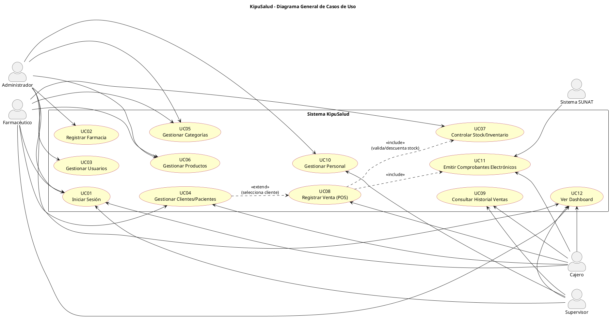

**Tabla resumen de casos de uso (para el cuerpo del informe):**

| # | Caso de Uso | Actor Principal | Descripción Breve |
|---|-------------|-----------------|-------------------|
| UC01 | Iniciar Sesión | Todos | Autenticación JWT vía auth-service. |
| UC02 | Registrar Farmacia | Administrador | Alta de empresa/tenant en el sistema. |
| UC03 | Gestionar Usuarios | Administrador | Crear/habilitar usuarios con roles específicos. |
| UC04 | Gestionar Clientes/Pacientes | Cajero, Farmacéutico | CRUD de clientes y ficha clínica. |
| UC05 | Gestionar Categorías | Admin, Farmacéutico | Clasificación del catálogo de productos. |
| UC06 | Gestionar Productos | Admin, Farmacéutico | Alta/edición de medicamentos y productos. |
| UC07 | Controlar Stock/Inventario | Farmacéutico | Consultas de existencias, alertas y vencimientos. |
| UC08 | Registrar Venta (POS) | Cajero | Venta con detalles, cálculo de total y medio de pago. |
| UC09 | Consultar Historial Ventas | Cajero, Supervisor | Listado y detalle de ventas realizadas. |
| UC10 | Gestionar Personal | Admin, Supervisor | CRUD del personal de la farmacia. |
| UC11 | Emitir Comprobantes Electrónicos | Cajero | Factura/boleta electrónica (integración SUNAT). |
| UC12 | Ver Dashboard | Todos | Métricas de ventas, clientes, productos y stock. |

---

<a name="a2-especificaciones-de-casos-de-uso"></a>
## A.2 Especificación de Casos de Uso (2 por participante)

### 👤 Participante 1 — Módulo: Autenticación

#### UC01 – Iniciar Sesión
- **Actor:** Administrador / Farmacéutico / Cajero / Supervisor
- **Precondición:** Usuario registrado con rol asignado.
- **Secuencia Básica:**
  1. El sistema muestra la pantalla de login (`/auth/login`).
  2. El usuario ingresa username y contraseña.
  3. Frontend envía POST `/api/auth/login` al auth-service.
  4. Se valida credencial (BCrypt) y se genera token JWT con el rol.
  5. El sistema redirige al Dashboard según el rol.
- **Extensiones:** Credenciales inválidas → mensaje de error.
- **Postcondición:** Sesión activa; guardado del token y navegación protegida.
- **Capturas a incluir:** pantalla de Login, mensaje de error, dashboard posterior.

#### UC02 – Registrar Farmacia
- **Actor:** Administrador (nuevo cliente SaaS)
- **Precondición:** No existir cuenta para la razón social ingresada.
- **Secuencia Básica:**
  1. Ingresar a `/auth/registro`.
  2. Completar nombre de farmacia, username y password.
  3. POST `/api/auth/registro`.
  4. El sistema crea el tenant y el usuario ADMIN.
  5. Muestra éxito y deriva a login.
- **Reglas de Negocio:** Username único; contraseña mínima 8 caracteres cifrada BCrypt.
- **Capturas a incluir:** formulario vacío, formulario completado, mensaje de éxito.

### 👤 Participante 2 — Módulo: Ventas

#### UC08 – Registrar Venta (Punto de Venta)
- **Actor:** Cajero
- **Precondición:** Usuario autenticado (rol CAJERO); productos con stock disponible.
- **Secuencia Básica:**
  1. Ingresar a `/ventas/nueva`.
  2. Seleccionar cliente (buscador).
  3. Agregar productos al carrito con cantidades.
  4. Validar stock contra inventario (catalogo-service).
  5. Calcular IGV y total.
  6. Seleccionar medio de pago.
  7. Confirmar → POST `/api/ventas`; descuenta stock y registra venta+detalles.
  8. Mostrar comprobante.
- **Extensiones:** Stock insuficiente → alerta y bloqueo de ítem.
- **Reglas de Negocio:** Descuento de stock transaccional; toda venta debe tener ≥1 detalle.
- **Capturas a incluir:** pantalla POS con carrito, validación de stock, venta confirmada.

#### UC09 – Consultar Historial de Ventas
- **Actor:** Cajero, Supervisor
- **Secuencia Básica:**
  1. Ingresar a `/ventas`.
  2. Listar ventas con filtros por fecha.
  3. Clic en una venta → `/ventas/:id` muestra detalle completo.
- **Capturas a incluir:** listado de ventas, detalle de una venta.

### 👤 Participante 3 — Módulo: Catálogo e Inventario

#### UC06 – Gestionar Productos
- **Actor:** Farmacéutico / Administrador
- **Precondición:** Existir al menos una categoría registrada.
- **Secuencia Básica:**
  1. Ingresar a `/catalogo/productos`.
  2. Listado paginado con buscador.
  3. "Nuevo producto" → formulario (nombre, categoría, presentación, precios, stock inicial, vencimiento).
  4. POST `/api/productos`.
  5. Mensaje de éxito y actualización de tabla. Permite Editar/Eliminar.
- **Extensiones:** Datos incompletos → validaciones reactivas impiden envío.
- **Capturas a incluir:** lista de productos, modal/formulario nuevo, producto editado.

#### UC07 – Controlar Stock / Inventario
- **Actor:** Farmacéutico
- **Secuencia Básica:**
  1. Ingresar a `/inventario`.
  2. Visualizar existencias por producto.
  3. Registrar ajuste/entrada de stock (POST `/api/inventario`).
  4. Sistema marca en rojo productos bajo stock mínimo.
- **Reglas de Negocio:** El stock nunca puede ser negativo.
- **Capturas a incluir:** tabla de inventario, alerta de stock bajo, ajuste realizado.

### 👤 Participante 4 — Módulo: Clientes y Personal

#### UC04 – Gestionar Clientes/Pacientes
- **Actor:** Cajero, Farmacéutico
- **Secuencia Básica:**
  1. Ingresar a `/clientes`.
  2. Listar/buscar por documento o nombre.
  3. Nuevo cliente: nombres, apellidos, tipo/número de documento, teléfono, correo.
  4. Guardar → POST `/api/clientes`.
  5. Opción "Ficha clínica" para alergias y antecedentes.
- **Capturas a incluir:** lista de clientes, formulario de registro, ficha clínica.

#### UC10 – Gestionar Personal
- **Actor:** Administrador / Supervisor
- **Secuencia Básica:**
  1. Ingresar a `/personal`.
  2. Listar personal.
  3. Alta/edición: nombres, documento, cargo, título profesional (Q.F.), colegiatura, sueldo, estado.
  4. POST/PUT `/api/personal`.
- **Capturas a incluir:** lista de personal, formulario de registro de personal.

#### UC12 – Ver Dashboard
- **Actores:** Administrador, Farmacéutico, Cajero, Supervisor.
- **Precondición:** Usuario autenticado con token JWT válido (cualquier rol); el módulo de personal solo se consulta para roles ADMINISTRADOR o QF_REGENTE.
- **Secuencia Básica:**
  1. El usuario ingresa al módulo del dashboard (`/dashboard`) tras iniciar sesión o seleccionar la opción del menú.
  2. El sistema muestra las tarjetas de resumen con los contadores de clientes, productos, ventas y personal registrados en la farmacia.
  3. El frontend ejecuta las peticiones simultáneas GET a `/api/clientes`, `/api/productos`, `/api/ventas` y `/api/personal` mediante el API Gateway.
  4. El sistema renderiza el gráfico de barras con las ventas mensuales agrupadas por mes (en soles) y el gráfico de stock por producto.
  5. El usuario puede visualizar el estado general de la operación de la farmacia en tiempo real.
- **Regla de Negocio:** La tarjeta de personal solo se carga para roles con acceso a información sensible (Administrador / Q.F. Regente); para Cajero y Supervisor este contador se omite sin romper la vista.
- **Secuencia Alternativa:** Si alguna petición falla (conexión interrumpida o servicio indisponible), el sistema muestra el mensaje de error "No se pudieron cargar los datos. Verifica tu conexión e inténtalo de nuevo." y permanece en la vista sin bloquear la navegación.
- **Postcondición:** Resumen operativo de la farmacia visualizado; métricas actualizadas al momento de la consulta.
- **Capturas a incluir:** dashboard con tarjetas de estadísticas, gráfico de ventas mensuales, gráfico de stock por producto, mensaje de error de carga.

---

<a name="b1-realizacion-de-casos-de-uso"></a>
## B.1 Realización de Casos de Uso (2 por participante)

### Participante 1 — Vistas de Capa de Presentación (Angular)

**RUC01 – Iniciar Sesión (diagrama de componentes):**

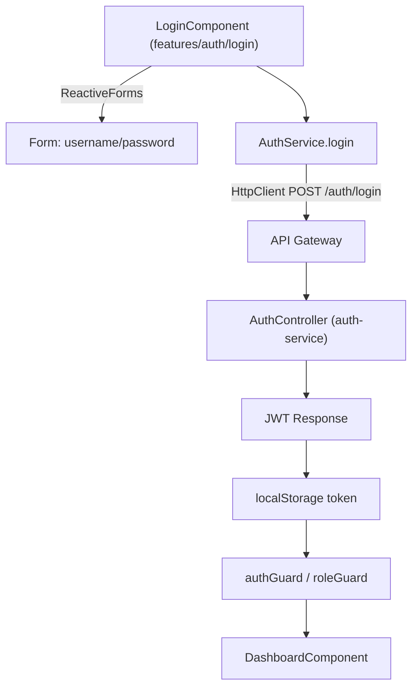

**RUC08 – Registrar Venta (vista de implementación):**

```text
VentaNuevaComponent (features/ventas/venta-nueva)
   ├── ClienteAutocomplete → ClienteService.getAll()
   ├── ProductoBuscador    → ProductoService.search()
   ├── Carrito[]           (items: producto, cant, precio, subtotal)
   ├── VentaService.registrar(VentaRequest) → POST /api/ventas
   │      └── ventas-service: valida stock (Feign→catalogo-service),
   │          guarda venta + detalles, descuenta stock (@Transactional)
   └── VentaDetalleComponent muestra la venta registrada
```

### Participante 2 — Vistas de Controladores Backend (Java/Spring Boot)

**RUC06 – Gestionar Productos:**

```java
// ProductoController (catalogo-service)
@GetMapping    /api/productos        // listar + búsqueda
@GetMapping    /api/productos/{id}   // detalle
@PostMapping   /api/productos        // crear (ProductoService.guardar)
@PutMapping    /api/productos/{id}   // editar
@DeleteMapping /api/productos/{id}   // eliminar
```

**RUC04 – Gestionar Clientes:**

```java
// ClienteController (cliente-service)
@GetMapping /api/clientes ... 
@PostMapping / @PutMapping("/{id}") / @DeleteMapping("/{id}")
Capa servicio: ClienteService (lógica + validación de documento único)
Capa datos:    ClienteRepository (JPA -> PostgreSQL clientes_db)
```

### Participante 3 — Modelo de Análisis (Entidades)

**RUC07 – Inventario:** Entidad `Producto` con atributos `stock`, `stockMinimo`; operación `AjustarStock(cantidad, motivo)` delegada desde `InventarioController`.

**RUC10 – Personal:** Entidad `Personal` (nombres, documento, cargo, tituloProfesional, numeroColegiatura, sueldo, estado) en `personal-service`, accesible solo con roles autorizados.

**RUC12 – Ver Dashboard (vista de implementación):**

```text
DashboardComponent (features/dashboard)
   ├── StatsCardsComponent (widget: contadores clientes/productos/ventas/personal)
   ├── ChartService.getVentasMensuales() → GET /api/ventas?agrupar=mes (ventas-service)
   ├── ProductoService.getAll() → GET /api/productos (catalogo-service, gráfico de stock)
   ├── ClienteService.getAll() / PersonalService.getAll() → peticiones paralelas (forkJoin)
   ├── RoleGuard: si rol != ADMIN/QF_REGENTE → oculta tarjeta de personal
   └── Manejo de error → mensaje "No se pudieron cargar los datos..."
```

### Participante 4 — Actividad / Estados

**RUC08 Flujo de estados de la Venta:**

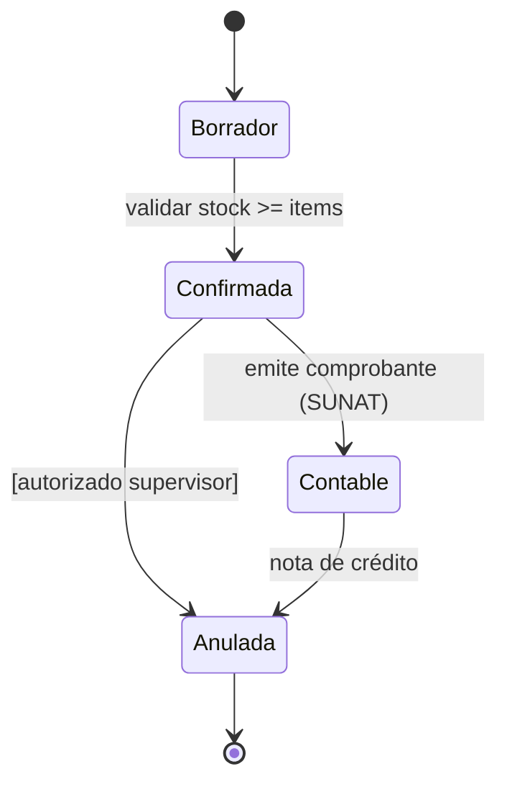

---

<a name="b2-diagrama-de-clases-de-analisis"></a>
## B.2 Diagrama de Clases de Análisis

**Herramienta sugerida:** PlantUML (Class Diagram).

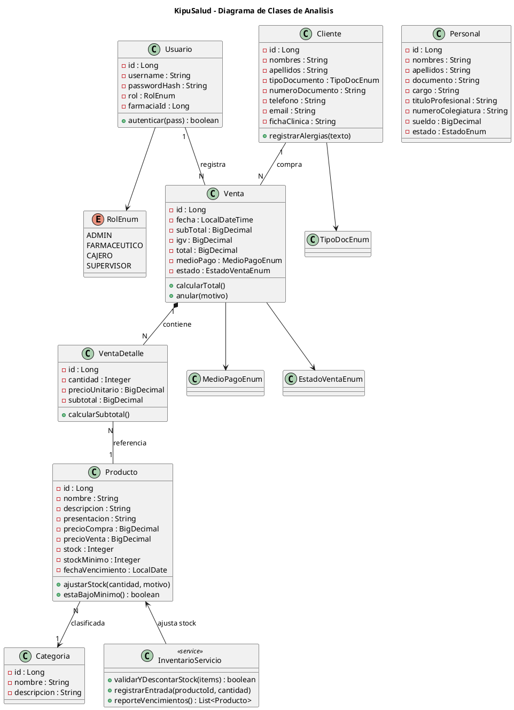

**Asociaciones clave (texto de respaldo):**
- Cliente 1—N Venta · Venta 1—N VentaDetalle · VentaDetalle N—1 Producto · Producto N—1 Categoria · Usuario 1—N Venta · Producto ←(ajustado por)→ InventarioServicio.

---

<a name="b3-diagramas-de-comunicacion--secuencia"></a>
## B.3 Diagramas de Comunicación

### UC08 – Registrar Venta (diagrama de comunicación, PlantUML)

```plantuml
@startuml
title Comunicacion - UC08 Registrar Venta
skinparam sequenceMessageAlign center

object "VentaNuevaComponent\n(Angular)" as UI
object "VentaService\n(frontend)" as FVS
object "API Gateway" as GW
object "VentaController\n(ventas-service)" as VC
object "VentaService\n(backend)" as VS
object "InventarioClient\n(Feign)" as IC
object "InventarioController\n(catalogo-service)" as INVC
object "ProductoRepository" as PR
object "VentaRepository" as VR

UI -> FVS : 1: registrarVenta(dto)
FVS -> GW : 2: POST /api/ventas
GW -> VC : 3: route + JWT filter
VC -> VS : 4: guardar(VentaRequest)
VS -> IC : 5: validarYDescontarStock(items)
IC -> INVC : 6: HTTP interno
INVC -> PR : 7: UPDATE stock (-cant)
PR --> INVC : 8: ok
INVC --> IC : 9: valido
IC --> VS : 10: resultado stock
VS -> VR : 11: save(venta + detalles) [@Transactional]
VR --> VS : 12: Venta(id)
VS --> VC : 13: VentaDTO
VC --> GW : 14: 201 Created
GW --> FVS : 15: respuesta
FVS --> UI : 16: navegar /ventas/:id
@enduml
```

Versión alternativa en **Mermaid** (si la otra IA prefiere Mermaid):

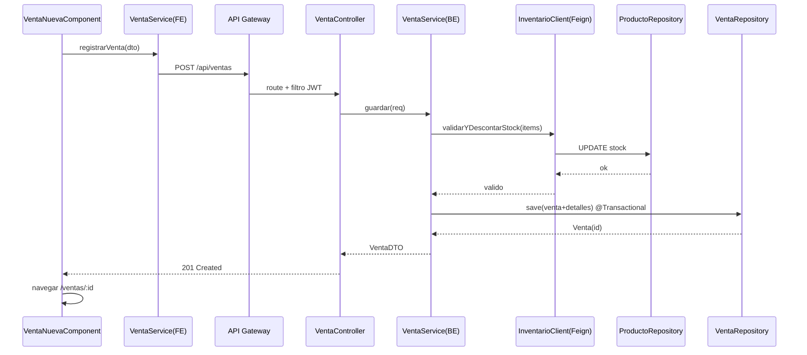

### UC01 – Iniciar Sesión (diagrama de comunicación, PlantUML)

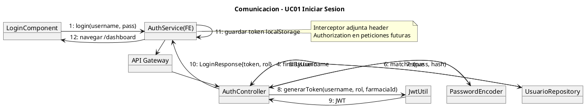

---

<a name="c-programacion-de-casos-de-uso-core"></a>
## C. Programación de Casos de Uso Core (matriz de trazabilidad)

La programación realizada corresponde exactamente a lo modelado en el punto B.

| Caso de uso core | Implementación (código real del repo) |
|---|---|
| UC01/UC02 Autenticación | `auth-service/.../AuthController.java` + `frontend/src/app/services/auth.service.ts` + interceptores JWT y guards (`authGuard`, `roleGuard`) |
| UC04 Clientes | `cliente-service/.../ClienteController.java` + `features/clientes/*` (list, form, ficha clínica) |
| UC05/UC06 Catálogo | `catalogo-service/.../CategoriaController.java`, `ProductoController.java` + `features/catalogo/*` |
| UC07 Inventario | `catalogo-service/.../InventarioController.java` + `features/inventario/inventario.component.ts` |
| UC08/UC09 Ventas | `ventas-service/.../VentaController.java` + `features/ventas/*` (venta-nueva, venta-list, venta-detalle) |
| UC10 Personal | `personal-service/.../PersonalController.java` + `features/personal/*` |
| UC11 Comprobantes | ver `docs/sunat-electronic-invoicing.md` (integración SUNAT) |
| UC12 Dashboard | `features/dashboard/dashboard.component.ts` + widget `stats-cards` |
| Infraestructura | Eureka (`discovery-server`), Config Server, API Gateway, PostgreSQL multi-DB (`database.sql`), Docker Compose |

**Fragmento representativo (crear producto — UC06):**

```java
@RestController
@RequestMapping("/api/productos")
public class ProductoController {
    private final ProductoService service;

    @PostMapping
    public ResponseEntity<ProductoDTO> crear(@Valid @RequestBody ProductoRequest req) {
        return ResponseEntity.status(HttpStatus.CREATED).body(service.guardar(req));
    }
}
```

**Fragmento representativo (registrar venta — UC08, frontend):**

```typescript
registrarVenta(): void {
  const dto: VentaRequest = { clienteId: this.clienteId, items: this.carrito, medioPago: this.medioPago };
  this.ventaService.registrar(dto).subscribe({
    next: v => this.router.navigate(['/ventas', v.id]),
    error: e => this.alerta.error('No hay stock suficiente')
  });
}
```

**Enlace de despliegue (aplicación web):** incluir en el informe algo como:
> Aplicación desplegada en: `https://kipusalud.<proveedor>.app` — Usuario demo: `admin / <contraseña>`
> (Frontend Angular → Vercel/Netlify; microservicios → Render/Railway o `docker-compose.yml` del repo.)

---

<a name="anexo-arquitectura"></a>
## Anexo: Guía de Despliegue en AWS

La guía completa de despliegue en la nube (EC2 + Docker Compose, Route 53, RDS, costos y alternativas ECS/Lightsail) está en el documento separado: [`guia-despliegue-aws.md`](guia-despliegue-aws.md). Úsala para completar la sección C del informe con el enlace de la aplicación desplegada.

## Anexo: Diagrama de Arquitectura de Microservicios (Mermaid)

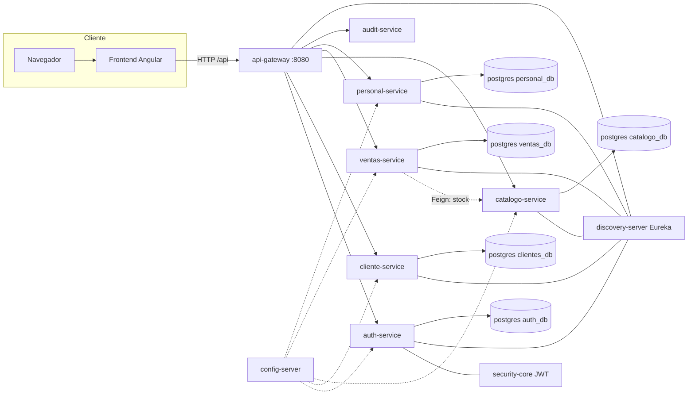

---

---

## Imágenes Renderizadas (PNG) — listas para insertar en el informe

Todas las imágenes fueron generadas a partir de los bloques de código de este documento y se encuentran en `docs/diagrams/`:

| Diagrama | Archivo PNG | Fuente | Sección del informe |
|---|---|---|---|
| Diagrama General de Casos de Uso | 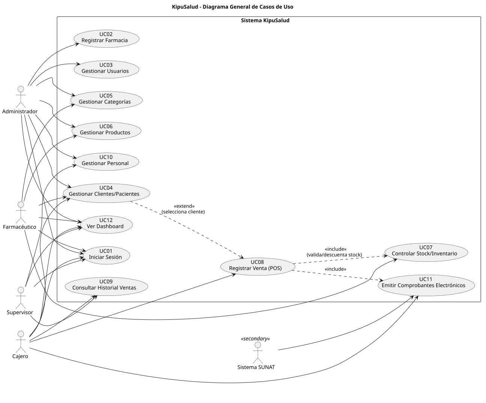 `diagrams/A1-diagrama-casos-de-uso.png` | PlantUML | A.1 |
| Componentes Login (RUC01) | 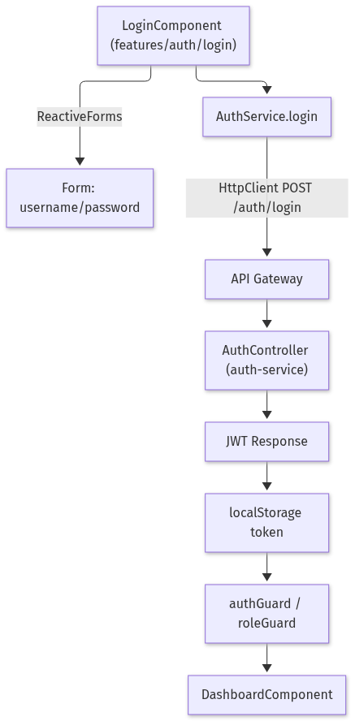 `diagrams/B1-componentes-login.png` | Mermaid | B.1 |
| Estados de la Venta (RUC08) | 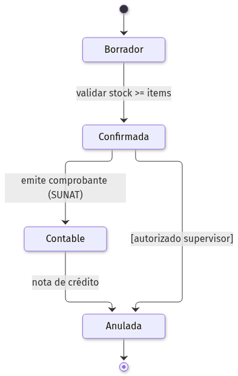 `diagrams/B1-estados-venta.png` | Mermaid | B.1 |
| Diagrama de Clases de Análisis | 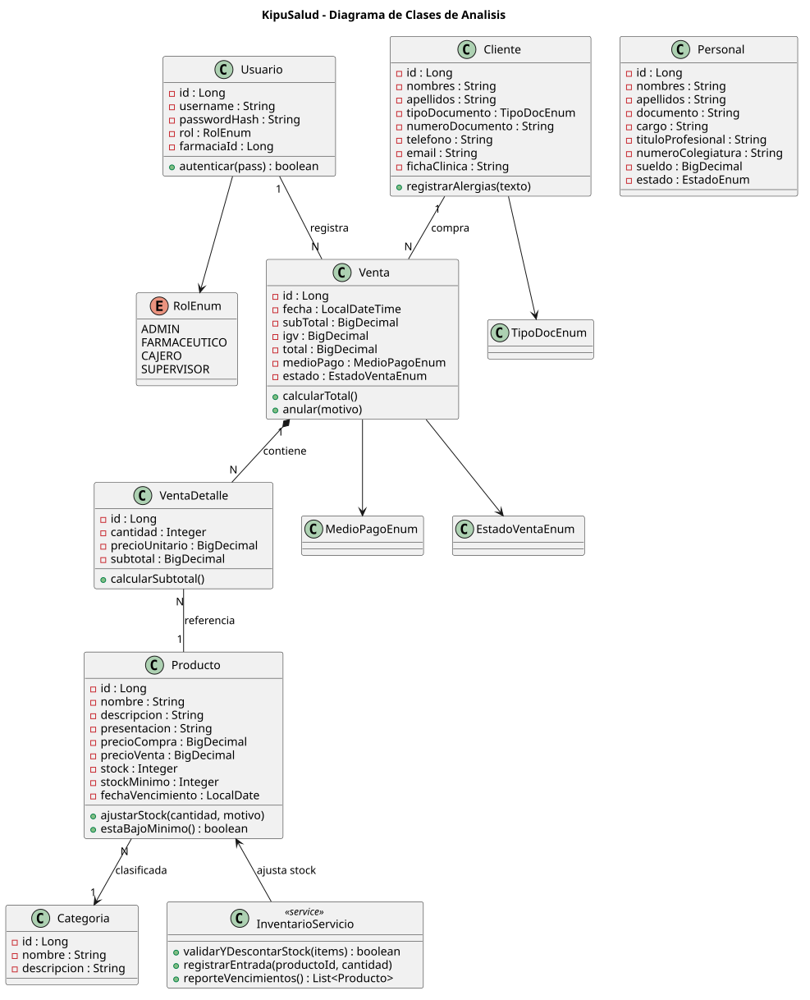 `diagrams/B2-diagrama-clases.png` | PlantUML | B.2 |
| Comunicación UC08 Registrar Venta | 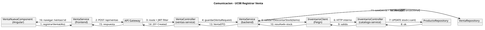 `diagrams/B3-comunicacion-venta.png` | PlantUML | B.3 |
| Secuencia UC08 (alternativa) | 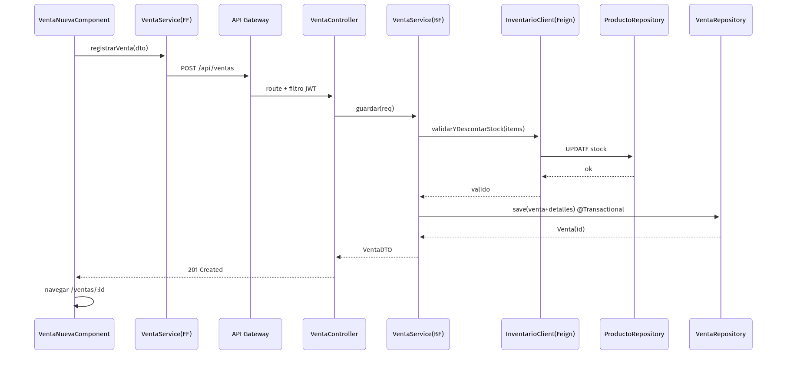 `diagrams/B3-secuencia-venta-alt.png` | Mermaid | B.3 |
| Comunicación UC01 Iniciar Sesión | 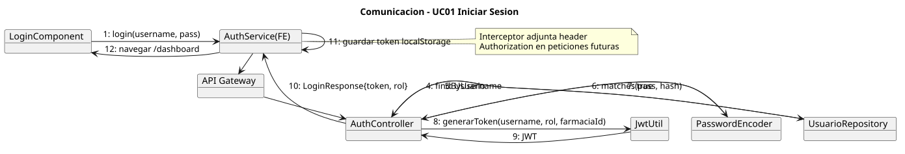 `diagrams/B3-comunicacion-login.png` | PlantUML | B.3 |
| Arquitectura de Microservicios | 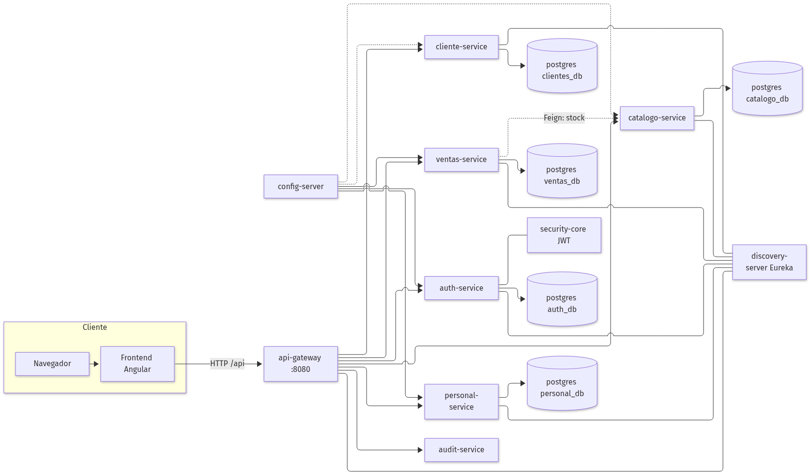 `diagrams/Anexo-arquitectura.png` | Mermaid | Anexo |

---

### Instrucciones finales para la IA receptora
1. Cada entregable está disponible **dos veces**: como código fuente (bloques ````plantuml` / ````mermaid`) y como imagen PNG pre-renderizada en `docs/diagrams/`. Puedes usar cualquiera de las dos formas.
2. Si necesitas regenerar o editar un diagrama: toma el bloque de código correspondiente, modifícalo y vuelve a renderizarlo (PlantUML → plantuml CLI / plantuml.com; Mermaid → mermaid.live / mmdc / kroki.io).
   ⚠️ **Nota de compatibilidad (corregido):** todos los bloques PlantUML usan ahora las etiquetas estándar `@startuml … @enduml`. Las versiones anteriores usaban etiquetas con nombre (`@startkipusalud_*`), que fallan en Kroki y varios renderizadores en línea. Los PNG/SVG de `docs/diagrams/` ya fueron regenerados y validados desde estas fuentes corregidas (los 4 bloques devuelven SVG válido sin errores de sintaxis).
3. Para el informe final: insertar las PNGs en las secciones A.1, B.1, B.2, B.3 y el anexo según la tabla anterior.
4. Las "capturas de pantallas funcionales" NO son diagramas: deben obtenerse ejecutando la app (`docker-compose up -d` + frontend Angular en `http://localhost:4200`) y capturando las rutas indicadas en cada especificación (`/auth/login`, `/ventas/nueva`, `/catalogo/productos`, `/inventario`, `/clientes`, `/personal`, `/dashboard`).
