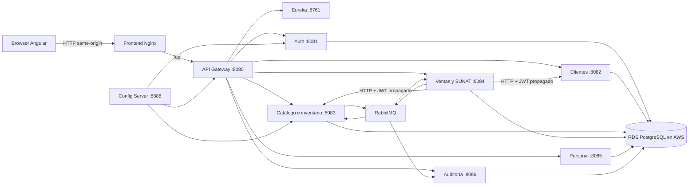

# Guía de traspaso técnico para una LLM

**Propósito:** permitir que otro agente entienda el producto y continúe trabajo
sin confundir documentación histórica, código local y estado AWS.

**Instantánea de referencia:** revisión del repositorio y AWS el 2026-11-23;
repo `main`, commit `7dd684f`. El código/configuración puede cambiar después.

## Orden recomendado de lectura

1. [README del repositorio](../README.md) y [reglas de agentes](../AGENTS.md).
2. [Arquitectura, módulos y seguridad](arquitectura-tecnica.md).
3. [Contratos REST, SOAP y rutas de interfaz](referencia-api.md).
4. [Entidades, bases y migraciones](modelo-datos.md).
5. [Ejecución local, Docker, configuración y estado AWS](operaciones.md).
6. [Topología EC2 + RDS PostgreSQL y runbook de solo lectura](infraestructura-aws.md).
7. La página especializada necesaria: [SUNAT](sunat-electronic-invoicing.md),
   [troubleshooting de API](troubleshooting-snackbar-conexion.md) o
   [casos de uso/entregables](entregables-uml-kipusalud.md).

## Qué es el producto

KipuSalud es una aplicación multi-tenant para administrar una farmacia:
catálogo y categorías, lotes con fechas de vencimiento, inventario/Kardex,
clientes, ventas, usuarios y permisos, personal, reportes y emisión electrónica
de facturas en SUNAT. La interfaz SPA es Angular; la API está dividida en
servicios Spring Boot.

## Estado técnico y GitHub

- Repositorio GitHub privado: `elMarce2007/Kipusalud`.
- Rama principal observada: `main`; commit de referencia: `7dd684f`.
- El árbol inspeccionado contiene diez módulos Maven (incluido `security-core`)
  y una aplicación Angular en `frontend/`.
- En GitHub, Issues y Wiki estaban habilitados al momento de consulta. La
  protección de ramas, reglas de aprobación y Actions settings no se verificaron.
- No se encontraron workflows versionados en `.github/workflows/`; pruebas,
  builds y despliegues no están configurados allí como CI/CD.
- `.github/modernize/` contiene artefactos de modernización y casos de uso; no
  constituye un pipeline ni configuración de despliegue.
- No hay contrato OpenAPI encontrado; los controladores y DTOs enlazados en
  [referencia API](referencia-api.md) son la fuente del contrato actual.

## Arquitectura resumida

El dibujo muestra relaciones lógicas, no implica que todos los servicios
compartan una única base física. Localmente Compose define seis bases
PostgreSQL separadas; en AWS, la instantánea inspeccionada conectaba cada
servicio a la misma instancia RDS PostgreSQL y seleccionaba una base lógica
distinta. Ver [operaciones](operaciones.md).

## Módulos

| Módulo | Responsabilidad | Puerto interno Docker |
|---|---|---:|
| `frontend/` | SPA Angular, Nginx y proxy `/api` al gateway | 80; publicado como host 80 |
| `api-gateway/` | Enrutamiento Spring Cloud Gateway, validación JWT en rutas protegidas y CORS | 8080 |
| `discovery-server/` | Registro y descubrimiento Eureka | 8761 |
| `config-server/` | Configuración centralizada, perfil `native,docker` en Compose | 8888 |
| `security-core/` | Filtro JWT multi-tenant, roles, permisos, `TenantContext`, contrato `DomainEvent` | librería |
| `auth-service/` | Registro/login, farmacias, usuarios, permisos y sesiones demo | 8081 |
| `cliente-service/` | CRUD clientes, datos tributarios, información clínica y auditoría de acceso clínico | 8082 |
| `catalogo-service/` | Categorías, productos, lotes, inventario, Kardex, alertas e importación inicial | 8083 |
| `ventas-service/` | Ventas/pagos, integración con cliente y catálogo, outbox, facturación SUNAT | 8084 |
| `personal-service/` | Personal, exportación CSV y servicio SOAP CXF | 8085 |
| `audit-service/` | Persistencia de eventos de dominio en auditoría | 8086 |

La responsabilidad de esquema/base por servicio y sus tablas aparecen en
[modelo de datos](modelo-datos.md).

## Interfaz Angular

Rutas de primer nivel:

- `/`: landing pública.
- `/auth/login`, `/auth/registro`: acceso y creación de farmacia.
- `/dashboard`, `/clientes`, `/catalogo`, `/ventas`, `/inventario`,
  `/personal`, `/usuarios`, `/farmacia`, `/administracion`: zona autenticada.
- El catálogo añade categorías/productos y formularios nuevos/edición; clientes,
  personal y ventas tienen listados/detalles y formularios.
- Las rutas cargan componentes lazy. `authGuard`, `permissionGuard` y
  `roleGuard` controlan navegación.

`AuthService` mantiene el usuario/JWT en `localStorage`. El interceptor añade
`Authorization: Bearer …`; el interceptor de errores muestra mensajes y cierra
sesión ante 401 cuando corresponde. Los guards son UX, no reemplazan la
validación del backend. Los detalles están en `frontend/src/app/app.routes.ts`,
`core/guards/`, `core/interceptors/`, `features/` y `services/`.

## Reglas de negocio que no deben perderse

- Cada registro de negocio lleva `farmacia_id`; debe leerse/escribirse bajo el
  tenant del JWT y limitarse en cada consulta.
- Los roles base son `ADMINISTRADOR`, `GERENTE_SUPERVISOR`, `QF_REGENTE` y
  `EMPLEADO`. Permisos usan valores `MODULO:VER`, `MODULO:GESTIONAR` y
  `FARMACIA:EDITAR`. El gerente puede recibir delegación limitada; consulta
  `security-core/.../RolePermissions.java`.
- El catálogo conserva stock agregado de producto y el detalle verificable por
  lote; el vencimiento se almacena como `LocalDate`. Las ventas descuentan
  primero lotes vigentes por FEFO.
- Los ingresos de mercancía, salidas de venta y ventas son idempotentes. Una
  repetición con la misma clave y payload devuelve el resultado previo; un
  payload distinto con la misma clave da conflicto.
- Venta se crea inicialmente como pendiente de stock, valida cliente/productos
  por HTTP, confirma salida de inventario y luego cambia a `CONFIRMADA`. Si el
  catálogo no está disponible, no debe informarse como confirmada. Consulta
  `VentaServiceImpl` y `InventarioServiceImpl`.
- Outbox persiste eventos junto con cambios de negocio; un job los publica con
  confirmación RabbitMQ. Consumidores guardan IDs procesados para deduplicar.
- Importación inicial admite CSV/XLSX validado; no ejecuta SQL del archivo.
  Solo se permite antes de que haya productos y está restringida a
  administrador.
- Las sesiones demo crean una farmacia aislada y cuatro cuentas aleatorias;
  vencen según TTL y se purgan con trabajo programado. La respuesta muestra las
  contraseñas una vez. No se deben incluir credenciales demo en docs o logs.
- SUNAT: XML UBL 2.1, certificado PKCS#12, SOAP 1.1; entorno beta por defecto.
  Producción está deshabilitada deliberadamente; ver documento SUNAT.

## Asuntos operativos que requieren atención

1. El estado AWS usa RDS PostgreSQL configurado mediante cambio local no versionado del
   Compose remoto. El Compose en Git apunta a `psql`; no asumas que un checkout
   nuevo conserva el endpoint de RDS.
2. El Compose remoto publica también `8080:8080` en el host. Esto requiere
   comprobar las reglas del Security Group; no equivale por sí solo a confirmar
   acceso desde Internet.
3. El código JDBC no fija explícitamente `sslmode=verify-full` ni una ruta al CA
   de RDS. La conexión PSQL de la consola de AWS no demuestra cómo negocia TLS
   JDBC. No afirmes que la validación del certificado está habilitada sin
   comprobar la configuración efectiva.
4. Documentación antigua contiene estado de AWS/usuarios de prueba previo; no
   uses sus credenciales ni procedimientos como actuales.
5. En AWS había archivos locales no versionados de backup y cambios de Compose.
   Presérvalos; no leer ni copiar dumps de datos sensibles.
6. Health checks Docker y `GET /actuator/health` no equivalen a CI, monitoreo
   externo, alertas ni backup restaurable probado.

Para metadatos, límites de acceso, checks de disco y guía de inspección para
LLMs, consulta [infraestructura-aws.md](infraestructura-aws.md).

## Al cerrar un cambio

1. Verifica `git status` y determina si existe trabajo ajeno; no lo sobrescribas.
2. Ejecuta las pruebas/build del módulo afectado según [operaciones](operaciones.md).
3. Actualiza docs relacionados si cambió un contrato o configuración.
4. Para cambios de despliegue, distingue siempre Compose versionado, overrides
   del servidor y secretos no versionados.
5. Reporta commit/branch, tests reales, desviaciones y cambios no desplegados.
