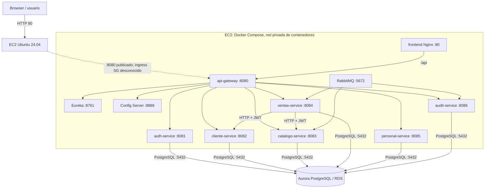

# Infraestructura AWS: EC2 + Aurora/RDS

Guía de contexto y operación para una persona o LLM que necesite entender el
despliegue actual sin confundirlo con Docker Compose local. Es una instantánea,
no una declaración de configuración inmutable.

**Última verificación del host:** 2026-11-23 15:26 (UTC-05:00), acceso de solo
lectura por SSH. **Región:** `us-east-2`. No se cambiaron recursos AWS.

## Resumen ejecutivo

KipuSalud se ejecuta en una instancia EC2 Ubuntu 24.04 con Docker Compose. La
base de datos PostgreSQL no corre en EC2: los seis servicios persistentes se
conectan a Aurora PostgreSQL en RDS. RabbitMQ sí corre como contenedor en EC2.



El diagrama es una vista lógica. No prueba las reglas actuales de Security
Groups, subnet routing ni el tipo de endpoint Aurora seleccionado. El frontend
usa Nginx y `/api`; el API Gateway también tiene un port mapping publicado
directamente en el host, cuya accesibilidad de red debe verificarse aparte.

## Inventario observado

### EC2 y runtime

| Propiedad | Observación |
|---|---|
| Región/AZ | `us-east-2` / `us-east-2c` |
| Sistema operativo | Ubuntu 24.04 |
| Tipo de instancia | `m7i-flex.large` |
| Memoria visible al host | aproximadamente 7.6 GiB |
| Almacenamiento raíz | aproximadamente 30 GB; `df` mostró 29 GB utilizables |
| Código | rama `main`, commit `7dd684f` |
| Directorio de trabajo | `/home/ubuntu/Kipusalud` |
| Contenedores Compose | 11 en ejecución y healthy en la comprobación |
| Docker Compose local `psql` | ausente en la configuración efectiva de servidor |
| AWS CLI en EC2 | no instalada al momento de la comprobación |

El uso de disco observado era 87% (3.8 GB disponibles). Es una lectura puntual,
no un umbral de alarma permanente: revisar crecimiento antes de builds o
actualizaciones, porque las imágenes y capas Docker compiten por ese espacio.

### Servicios y exposición del host

El Compose remoto reportó estos servicios: `frontend`, `api-gateway`,
`discovery-server`, `config-server`, `auth-service`, `cliente-service`,
`catalogo-service`, `ventas-service`, `personal-service`, `audit-service` y
`rabbitmq`. A diferencia del Compose versionado, no incluye `psql`.

| Servicio | Puerto de contenedor | Publicado en el host observado |
|---|---:|---|
| `frontend` | 80 | `80:80` |
| `api-gateway` | 8080 | `8080:8080` |
| Eureka, Config Server, auth, clientes, catálogo, ventas, personal, auditoría | 8081–8086, 8761, 8888 | sin port mapping |
| RabbitMQ | 5672, 15672 | sin port mapping |

`8080:8080` sin una dirección de host explícita enlaza normalmente a todas las
interfaces del host. **Esto no demuestra que Internet pueda acceder**: Security
Groups y rutas deciden el acceso externo, pero su configuración no se verificó.
Como Nginx atiende el frontend y pasa `/api` al gateway dentro de Docker, no se
necesita publicar el 8080 para el flujo normal del navegador. Antes de cambiar
Compose, verifica el Security Group y considera restringir/eliminar ese
port mapping. No abrir el 8080 públicamente por conveniencia.

Los contenedores de negocio, RabbitMQ, Eureka y Config Server están en la red
Docker del Compose. Solo la tabla anterior describe puertos publicados; no
infieras la exposición pública a partir de `EXPOSE` en Dockerfiles.

### Aurora PostgreSQL / RDS

Confirmado por la configuración efectiva del Compose remoto y el contexto de la
consola AWS proporcionado por el usuario:

- Motor indicado: Aurora PostgreSQL en `us-east-2`.
- Puerto PostgreSQL: `5432`.
- Endpoint configurado: endpoint externo de Aurora. La consola lo identificó
  como endpoint de instancia; el nombre DNS deliberadamente no se copia aquí.
- Gateway/conectividad a Internet: desactivada según la pantalla compartida; la
  propiedad RDS `PubliclyAccessible` no se consultó directamente.
- Autenticación de base por IAM: desactivada según esa consola.
- El contenedor local `psql` no participa; los servicios conectan desde EC2.
- Los seis servicios configuran `POSTGRES_HOST` al mismo host externo; cada
  servicio selecciona una base lógica distinta:

  | Servicio | Base lógica |
  |---|---|
  | auth | `auth_db` |
  | clientes | `clientes_db` |
  | catálogo/inventario | `catalogo_db` |
  | ventas | `ventas_db` |
  | personal | `personal_db` |
  | auditoría | `auditoria_db` |

Las bases son separación lógica sobre el mismo destino PostgreSQL, no seis
clusters/instancias independientes. Compose inyecta nombres de variable
`POSTGRES_USER`/`POSTGRES_PASSWORD`; no se comprobó si en RDS existen roles
distintos y grants mínimos por servicio. El ejemplo de conexión PSQL de la
consola usa valores por defecto de esa herramienta y no prueba qué usuario usa
JDBC en la aplicación.

El nombre exacto de cluster/instancia, versión menor de PostgreSQL, clase de
instancia RDS, estado writer/reader, endpoint de writer/cluster, subnet group,
Availability Zones, Security Groups, retención de backups, protección contra
borrado y política de snapshots **no se pudieron consultar en el control plane**:
AWS CLI no estaba instalada en EC2 y no se hizo una consulta con credenciales de
AWS. La configuración de aplicación prueba que hay un host externo, pero no
prueba por sí sola el estado de todos esos recursos.

### Estado del repositorio en EC2

El servidor ejecutaba commit `7dd684f`, pero el worktree estaba sucio. El
`docker-compose.yml` remoto se modificó localmente para apuntar a Aurora y hay
archivos locales no versionados, incluidos respaldos. No leer, imprimir, copiar,
versionar ni sobrescribir esos respaldos. No hacer `git pull`, build o checkout
sin revisar primero la divergencia y acordar cómo conservar la configuración
Aurora.

El Compose de Git aún configura un PostgreSQL local llamado `psql`, por lo que
**un clon nuevo no recrea la topología actualmente desplegada**.

No se encontraron archivos IaC versionados de Terraform/CloudFormation para
crear EC2, Aurora, redes o Security Groups. Por ahora esta topología se debe
tratar como recursos configurados fuera del repositorio; no inferir que un
`docker compose up` aprovisiona EC2 o RDS.

## Conexión EC2 → Aurora y límites de seguridad

El modelo de red esperado es EC2 en la VPC → endpoint privado de RDS por TCP
5432. Revisa en la consola autorizada que:

1. RDS no sea públicamente accesible.
2. El Security Group de RDS permita TCP 5432 solo desde el Security Group de
   EC2 (referencia de SG), no desde `0.0.0.0/0`.
3. La instancia EC2 y RDS estén en VPCs conectadas con rutas correctas.
4. El acceso SSH 22 esté limitado a los operadores autorizados.
5. El puerto web publicado sea el mínimo requerido; revisar explícitamente
   8080, porque el Compose remoto lo publica en el host.

Estos son controles que deben verificarse, no afirmaciones sobre la
configuración de red actual.

La consola dio un ejemplo de `psql` con `sslmode=verify-full` y
`global-bundle.pem`. Los URLs JDBC de la aplicación no declaran ese modo ni
archivo CA explícitamente. No afirmar que pgJDBC valida identidad/cadena TLS
hasta configurar y probarlo en los servicios; el ejemplo de consola no configura
los contenedores.

Aurora tiene endpoints distintos para cluster/writer e instancia. La consola
informó que se eligió un endpoint de instancia. Antes de diseñar recuperación o
failover, confirmar si se requiere el endpoint writer del cluster para que la
aplicación siga al writer promovido. No cambies el hostname en Compose sin
revisar cómo está configurada la topología y el failover.

## Cómo debe inspeccionar una LLM

### Primero, solo lectura en EC2

Usa la conexión SSH autorizada que proporcione el operador; no guardes ni
documentes IPs o paths de claves privadas. Una vez conectado:

```bash
cd /home/ubuntu/Kipusalud
git branch --show-current
git rev-parse --short HEAD
git status --short
docker compose ps --format '{{.Service}}|{{.State}}|{{.Health}}'
df -h /
free -h
```

- `git status` puede mostrar cambios locales y nombres de respaldos; no abras
  dumps ni `.env`.
- No ejecutes `docker compose config` sin filtrar: la configuración ya
  interpolada puede imprimir secretos.
- Para ver solo el inventario de servicios: `docker compose config --services`.
- `docker compose logs` puede incluir datos personales o tokens; inspecciona
  solo un servicio, limita líneas y redacta antes de compartir.
- No ejecutes `docker compose down -v`, no elimines volúmenes y no cambies
  reinicios/recursos por una solicitud de documentación.

Las observaciones de runtime se deben fechar. `healthy` en Docker solo valida
los healthchecks configurados, no disponibilidad externa, restaurabilidad de
backups ni consistencia funcional de ventas.

### Después, consola AWS o CLI de solo lectura

No instales AWS CLI ni solicites/guardes credenciales solo para documentar. Si
el operador ya tiene una sesión AWS autorizada, recoge únicamente metadatos:

- EC2: estado, tipo, AZ, subnet, SG, volúmenes EBS y fecha de lanzamiento.
- RDS: tipo de recurso (cluster/instancia), motor/versión, writer, estado,
  endpoint type, AZ, subnet group, SG, acceso público, backup retention,
  deletion protection y ventana de mantenimiento.
- Red: VPC, rutas, NACL/SG relevantes y origen de la regla 5432.

Ejemplos de AWS CLI **solo lectura**; no pidas ni pongas claves en argumentos:

```bash
aws ec2 describe-instances --region us-east-2 \
  --filters Name=instance-id,Values=i-REPLACE_WITH_INSTANCE_ID \
  --query 'Reservations[].Instances[].{Type:InstanceType,State:State.Name,AZ:Placement.AvailabilityZone,Subnet:SubnetId,SecurityGroups:SecurityGroups[].GroupId,Volumes:BlockDeviceMappings[].Ebs.VolumeId}'

aws rds describe-db-clusters --region us-east-2 \
  --query 'DBClusters[].{Engine:Engine,Version:EngineVersion,Status:Status,Port:Port,BackupRetentionDays:BackupRetentionPeriod,DeletionProtection:DeletionProtection,SubnetGroup:DBSubnetGroup,Members:DBClusterMembers[].{Id:DBInstanceIdentifier,Writer:IsClusterWriter},SecurityGroups:VpcSecurityGroups[].VpcSecurityGroupId}'

aws rds describe-db-instances --region us-east-2 \
  --query 'DBInstances[].{Engine:Engine,Version:EngineVersion,Class:DBInstanceClass,Status:DBInstanceStatus,Public:PubliclyAccessible,AZ:AvailabilityZone,SubnetGroup:DBSubnetGroup.DBSubnetGroupName,SecurityGroups:VpcSecurityGroups[].VpcSecurityGroupId}'
```

Filtra por los IDs identificados por el operador en vez de documentar todos los
recursos de una cuenta. No copies salidas completas a archivos o conversaciones:
pueden revelar nombres internos, topología o IDs de recursos.

## Runbook seguro

### Revisar salud de aplicación

1. Captura branch/commit y worktree antes de cualquier intervención.
2. `docker compose ps` confirma el estado y healthcheck de los 11 servicios.
3. Diagnostica un servicio a la vez; revisa Eureka y DB antes de reinicios en
   cascada.
4. Usa logs acotados y redactados; nunca imprime `.env`, variables
   interpoladas, JWT, contraseñas ni datos clínicos/clientes.
5. Prueba `/` y una operación de lectura no destructiva, con autorización y
   tenant de prueba explícitos.

### Revisar conexión DB

- Confirma desde cada contenedor solo si `POSTGRES_HOST` está configurado como
  externo y que puerto sea 5432; evita imprimir su valor en un transcript.
- Verifica DNS/ruta/SG de EC2 hacia RDS. No pruebes abriendo 5432 públicamente.
- Comprueba base destino y versión Flyway por cada servicio con acceso
  autorizado.
- No ejecutes scripts SQL, migraciones manuales, `DROP`, `TRUNCATE`, seeds o
  pruebas de escritura en datos productivos sin una solicitud y plan aprobados.

### Backups y cambios

- Confirma en RDS retención de automated backups, ventana, snapshots y
  protección contra borrado. La instantánea actual no confirma ninguno.
- Antes de migraciones: backup aprobado, estado Flyway, plan de rollback y
  validación de restore; un snapshot sin restore probado no es una prueba de
  recuperación.
- No se debe cambiar `POSTGRES_HOST`, endpoint de cluster/instancia, Compose,
  Security Groups, EBS o RDS como parte de una tarea de documentación.
- Para una actualización de aplicación, primero concilia el Compose remoto
  modificado con la versión deseada sin eliminar los datos ni el override
  Aurora; despliega solo con autorización expresa.

## Plantilla de inventario para mantener esta guía

Completa valores solo con evidencia consultada; usa `no verificado` en vez de
inferir. No incluyas endpoints DNS completos, IPs públicas, credenciales, ARN
completos, claves o contenido de `.env`.

| Recurso | Estado/valor seguro | Evidencia y fecha |
|---|---|---|
| EC2: instancia/tipo/AZ/OS |  | Consola o metadata |
| EC2: VPC/subnet/SG/reglas ingress |  | Consola; redactar IPs de origen |
| EC2: EBS/tamaño/uso de disco |  | Consola + `df -h /` |
| Compose: commit/worktree/servicios/puertos |  | Host, solo lectura |
| RDS: cluster/instancias/writer/versión |  | Consola o CLI read-only |
| RDS: subnet group/SG/acceso público |  | Consola; no exponer DNS |
| RDS: backups/retención/protección/restores |  | Consola + evidencia de restore |
| JDBC: TLS/CA/hostname verification |  | Config efectiva + prueba |
| Aplicación: salud/último smoke test |  | Fecha, endpoint sin token |

## Diferencias frente al Compose local

| Área | Compose versionado (desarrollo) | EC2 observado |
|---|---|---|
| PostgreSQL | Contenedor `psql` con seis bases | Aurora PostgreSQL externo; sin `psql` local |
| Servicios de aplicación | 11 app/infraestructura + `psql` | 11 app/infraestructura |
| Gateway | `127.0.0.1:8080:8080` | `8080:8080` publicado al host |
| Frontend | `80:80` | `80:80` |
| Estado persistente | Volúmenes Docker local (PostgreSQL/RabbitMQ) | Aurora para DB; RabbitMQ mantiene volumen Docker local |

No uses las tablas de “Compose local” como evidencia de AWS. La configuración
efectiva del servidor y los metadatos autorizados de la cuenta prevalecen para
operar ese entorno.
